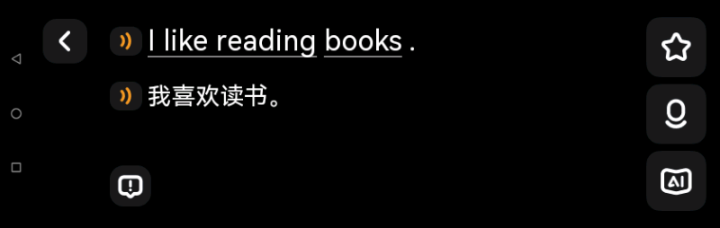

# 有道词典笔 3（YDP031）双系统 · Cherry Android

**保留原厂词典系统，同时运行 Android 8.1。安卓里完整还原了原生扫词的日常流程。** 在学习模式下，从桌面或其他应用直接落笔，沿纸上一行文字划过去，抬笔就能看到原厂横屏词典界面。扫单词有释义、音标和发音，扫句子可看中英译文、听整句朗读。第一行抬笔后约一秒内接扫第二行，两行会接成一句翻译。

**[到 GitHub Release 下载安装器](https://github.com/who-andy/ydp031-cherry-android/releases/latest)** · [Windows 刷机教程](docs/windows.md) · [Mac / Ubuntu 刷机教程](docs/start.md) · [实机效果](docs/results.md)

| 你想做什么 | 操作 |
| --- | --- |
| 第一次刷入双系统 | 下载上方 ZIP，解压，在 Mac 双击 `Start.command`，选择「1 安装双系统」。首次准备需要联网。 |
| 想先看看安装器 | 选择「2 只准备下载」，无需连接笔。 |
| 想在两套系统之间切换 | 安卓点「系统切换」，原厂桌面点绿色「返回安卓」。 |
| 想把内存让给前台应用 | 在安卓的「设备模式」里切到游戏模式。切回学习模式即可恢复落笔扫词。 |
| 想从源码构建 | [安装器打包、内核编译和应用构建](docs/build.md) |

本次首次安装面向 **YDP031CHNSTD、16 GB、原厂 B 槽 OS 3.4.6**。可用 Apple Silicon Mac、Ubuntu，或 Windows 11 x64 测试版。安装器会备份整笔，从自己的笔里读取原厂词典资源，在电脑上自动制作专用启动文件。两个原厂 system 分区和原厂 boot B 保留。安装及首次开机验证的边界见[实机效果](docs/results.md)。

这是社区适配的候选版本。项目与有道官方无隶属关系。
