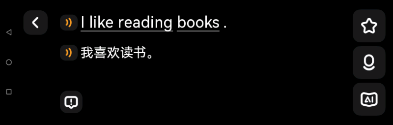
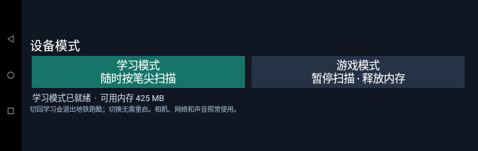
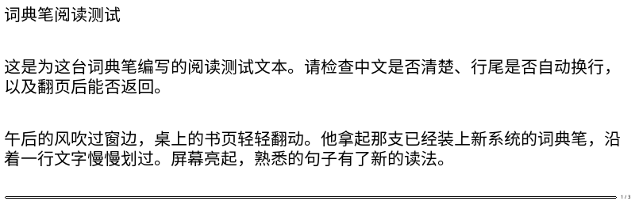

# 开发用词典笔的实机效果

这些截图来自 YDP031CHNSTD 上运行的安卓适配版。前半部分记录开发笔的使用效果，后半部分说明各版安装器在磁盘副本或 Windows 测试环境中完成的验证。

## 词典

扫一个单词可以看到原厂横屏释义、音标和例句。扫完整句子会出现中英文译文。实机操作中，从安卓桌面直接落笔能唤起词典；约一秒内接扫下一行，两行会合并翻译。用户实际听到了单词发音。

## 模式切换与阅读

学习模式保留随时扫词的后台。游戏模式暂停扫描，给前台应用腾出内存。截图中的内存是截屏时的瞬时读数。另一次在同一启动周期内的实测中，切换前后的系统可用内存相差约 **113 MiB**，OCR 工作进程由 1 个降到 0 个。切回学习模式后恢复为 1 个，并能再次落笔扫词。

以下为 KOReader 在词典笔上打开专用测试文本的横屏画面，已经实测换行和翻页。

## 外设与性能

| 项目 | 开发机观察结果 |
| --- | --- |
| 显示与输入 | Mali-G31 硬件图形加速已启用。桌面、触摸和三键导航可用，双指触控已验证。 |
| 扫描头 | 笔尖接触触发、持续采集、补光和抬笔结束可用。中英文整行 OCR、两行合并翻译已实测。 |
| 相机与音频 | 原生相机可拍照、录像并切换持续补光。24 帧/秒配置下，一段 640×480 录像约为 23.6 帧/秒，回放时画面和人声正常。 |
| 显示亮度、无线 | 安卓亮度滑条能实际改变屏幕亮度；Wi‑Fi 扫描并连接成功；蓝牙进入 ON，配对和耳机音频仍待测。 |
| 图形优化 | 同机固定点击测试中，缓存优化前后的应用帧耗时中位数分别为 19 ms 和 11 ms。这个指标反映该测试负载。默认 CPU 频率上限为 1.2 GHz。 |
| 双系统 | 开发机实测从安卓进入原厂，再通过原厂桌面按钮回到安卓；回到学习模式后扫词正常。 |

## 早期 RC1 安装与恢复演练

在由真实原厂文件重建的磁盘副本上，RC1 从目标备份导入了 562 项原厂资源和运行库。已验证错误序列号被拒绝、写入前发现目标变化、区块只写了一部分后可以继续安装，以及两个原厂 system 分区前后相同。单独凭备份和备份时记录的 SHA-256 恢复后，整盘 **15,518,924,800 字节**的摘要与初始副本一致。

目前还没有第二支未经改装词典笔完成 RC1 的首次冷启动和原厂桌面返回验证。[离线验收记录](validation.json)

## 公开下载版 v0.2.0-rc.1

本版的制作流程已在一份由开发机备份及原厂文件重建的磁盘副本上完整跑通。程序读取原厂资源，重建 system 与 vendor，登记原厂桌面的「返回安卓」，最终生成 **455 个差异块**。内核编译脚本使用的源版本、板级修改及配置也已在 ARM64 Ubuntu 上编译出 Image。

这一轮没有向另一支全新词典笔写入。上面的实际使用截图来自开发机；整盘写入中断续装与恢复验证属于前一版。

## Windows 安装器

Windows 版已完成 EXE 编译、解压后的整包自检、菜单启动和缺件拒绝测试。USB 识别使用模拟清单验证单设备、多设备和授权状态。Windows 直连实机的整盘备份、刷入、冷启动和恢复仍待验收。[Windows 构建与测试流程](../.github/workflows/windows-installer.yml)
