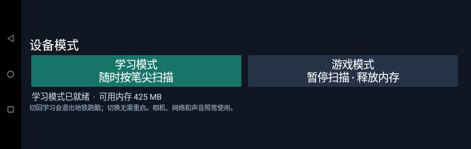
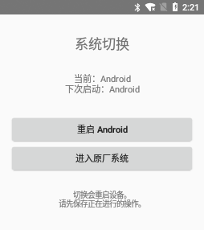
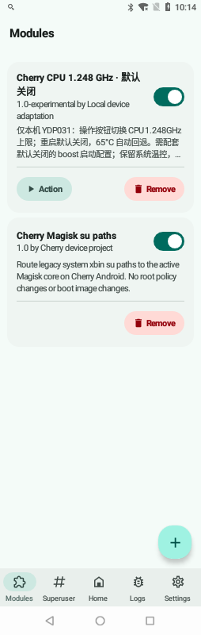

# 在词典笔上使用 Android

第一次开机可以先扫一个词、接扫两行，再试一次双向系统切换。

## 扫词、接句和发音

打开「设备模式」，点「学习模式」，等到显示已就绪后回桌面。让笔尖两个触点贴住纸面，沿一行文字平稳划过后抬起。词典会自动弹出，显示本次识别的原文、释义或译文。接扫长句时，在第一行抬起后约一秒内开始第二行。连续两行的合并翻译已经在开发机上实测。

点单词旁的喇叭可听发音。整句也支持中英文朗读，首次点击可能需要数秒加载，再次播放同一句通常更快。底部导航可返回上一级、回桌面或查看最近任务。

## 切换学习模式和游戏模式

点「设备模式 → 游戏模式」。状态显示已就绪后，词典后台和 OCR 进程退出，可以自己打开需要的应用。回到「学习模式」会重新启动后台，恢复全局笔尖扫描。两种模式切换都无需重启。

公开安装版包含 Magisk、原版词典、系统切换、设备模式、Via 浏览器、KOReader 和 glmark2 图形跑分。

## 相机、阅读和联网

安卓原生相机使用笔尖扫描头。选拍照或录像模式，让笔尖靠近纸面，可以从相机菜单里的闪电图标开启持续补光。开发机已验证录像回放时能看到移动的画面、听到麦克风录入的人声。逐行阅读请使用词典的滑扫入口。

KOReader 可以打开本机的电子书或文本，Via 用于浏览网页。Wi‑Fi 通过安卓设置选择网络并输入密码，亮度可在设置滑条中调节。蓝牙开关已验证，外部设备配对与耳机音频仍待实测。

## 两个系统之间切换

切换系统会重启整支笔，请先保存当前内容。

**从安卓进入原厂系统**。打开安卓桌面的「系统切换」。页面上方显示当前系统和下次启动的系统，点第二个按钮「进入原厂系统」，再点「确认」。

**从原厂系统返回安卓**。在原厂桌面横向翻动应用列表，找到下图的绿色「返回安卓」图标。打开后点「重启到安卓」。想留在原厂系统可以点「取消」。

如需回到安装前的分区与用户数据状态，按[备份恢复步骤](recovery.md)操作。

## Magisk 超频模块（开发机）

下图是开发笔上的 Magisk「Modules」（模块）页。第一张卡片是「Cherry CPU 1.248 GHz · 默认关闭」。右侧绿色开关表示 Magisk 已启用这个模块；要切换 CPU 频率上限，用的是同一卡片左下角的 **Action** 按钮。

开发笔配套配置的默认上限是 **1.2 GHz**，点一次 Action 可切到 **1.248 GHz**，再点一次恢复，重启后也会恢复默认值。公开安装版包含 Magisk；这张截图记录的是另行配置了实验模块的开发笔。
